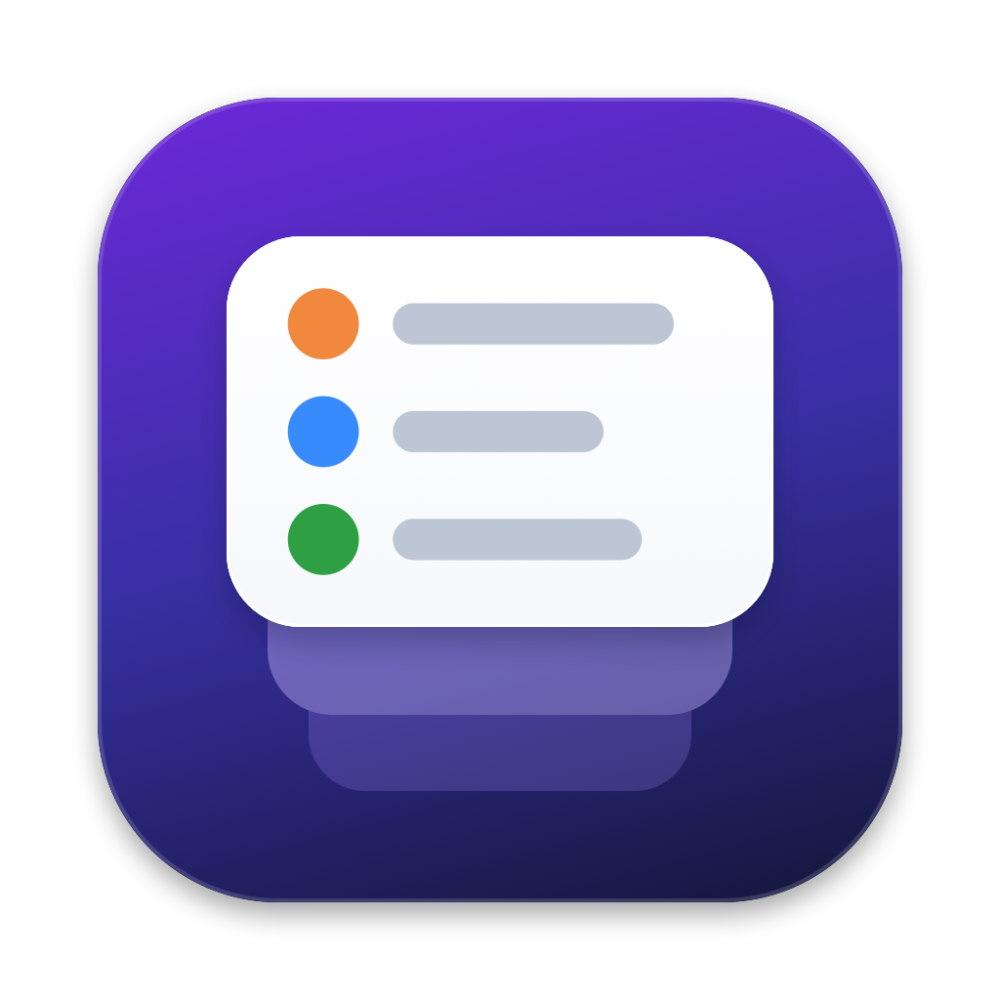
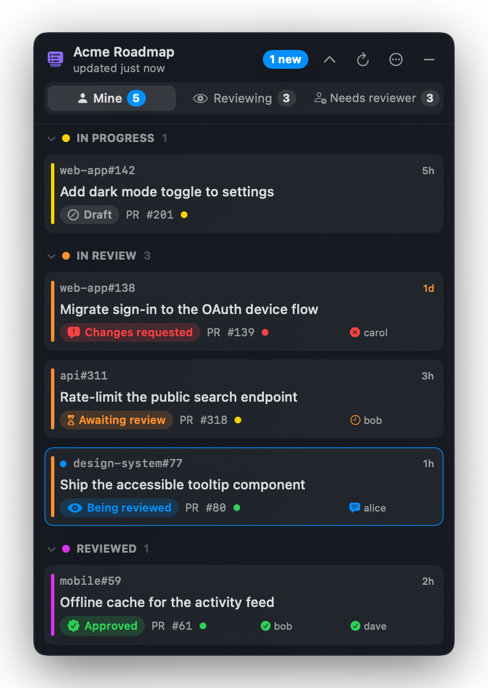
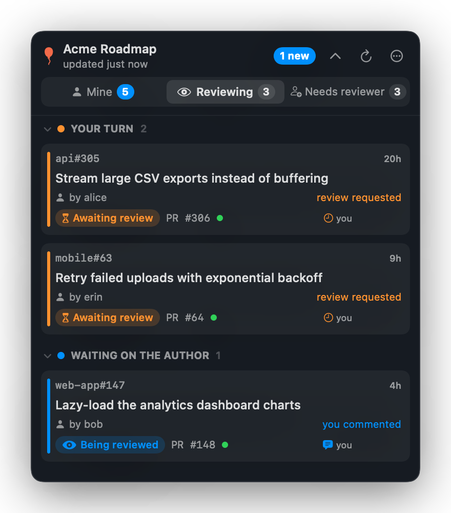
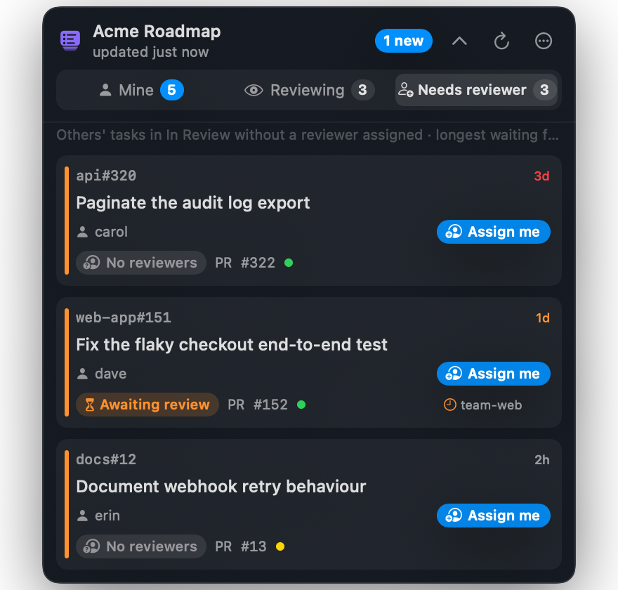
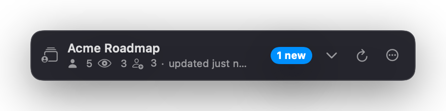

<p align="center">
  
</p>

<h1 align="center">GitHub Float</h1>

<p align="center">
  <b>Your GitHub Project's code reviews, always on top of your screen.</b><br>
  A tiny native macOS floating panel that shows what you put in review, who is reviewing it, and which teammates' PRs still need a reviewer.
</p>

<p align="center">
  <a href="https://github.com/vinimcorrea/github-float/releases/latest"></a>
  <a href="https://github.com/vinimcorrea/github-float/releases"></a>
  
  
  <a href="https://github.com/vinimcorrea/github-float/actions/workflows/ci.yml"></a>
  <a href="LICENSE"></a>
  <a href="https://github.com/vinimcorrea/github-float/stargazers"></a>
</p>

https://github.com/user-attachments/assets/4b6af66c-014e-48cd-9c81-252f03a28d49

---

## Why?

Your PR sits in **In Review** for two days because nobody noticed it. A teammate's PR waits for a reviewer while you're heads-down. You keep switching to the browser to check the board.

**GitHub Float** keeps your [GitHub Project](https://docs.github.com/issues/planning-and-tracking-with-projects) review flow in a small glass panel that floats above every window, on every Space, even over full-screen apps. Glance, don't switch.

## ✨ Features

- 🪟 **Always on top**: a non-activating floating panel that never steals focus, visible on all Spaces and over full-screen apps. Drag it anywhere; near a screen edge or corner it snaps into place like a magnet. Docked at the bottom, the header moves to the bottom row and the tasks open upwards, so the bar never jumps. The panel shrinks to fit short lists (folded sections leave no empty space) and grows back up to the size you dragged it to.
- 📌 **Attach to Menu Bar**: turn it on in the menu and the panel hangs right under the menu bar icon, with a popover arrow pointing at it; click the icon to show or hide it, and a click anywhere outside hides it again, like a menu bar popover. Right-click the icon for the options. Drag the panel away (or untick the option) to detach it and float it anywhere again.
- 👤 **Mine**: your tasks grouped by status (In Progress, In Review, Reviewed), each with its linked PRs. *User Stories* that have sub-issues are hidden: you follow them through their sub-issues.
- 🗂️ **Your layout**: click a section header to fold it, and drag headers to put the status you care about first (or right-click → *Move Up* / *Move Down*).
- 👀 **Reviewing**: the tasks you are reviewing for teammates, split into *Your turn* and *Waiting on the author*, with a notification when a re-review is requested.
- 🚚 **Moves the card for you**: approve and the card goes to the next status (e.g. *Reviewed*); request changes and it goes back to *In Progress* and you're unassigned. Toggle it with *Move Cards After My Review*. When all the PRs of one of your own tasks are merged, it goes to *Ready to Verify* from whatever earlier column it is in (*Move My Merged Tasks to Ready to Verify*). The same goes for a *User Story* split into sub-issues: once all its sub-issues are closed or in *Ready to Verify* (or later), the story moves to *Ready to Verify* too.
- 🔍 **Review state at a glance**: *awaiting review*, *being reviewed*, *changes requested*, *approved*, *merged*, plus the reviewers and CI status (✅ ❌ ⏳).
- 🙋 **Needs reviewer**: teammates' tasks in review with no second assignee, and an **Assign me** button that adds you as the reviewer without opening GitHub (the task then moves to *Reviewing*).
- ⏱️ **Time in status**: an age badge turns orange after 24h and red after 72h.
- 🔔 **Native notifications** when something needs you: a new review, changes requested, approval, failing CI, merged PR, a task moved forward, or a new task waiting for a reviewer. Each kind of event has its own synth sound (needs you, good news, bad news, comment), and you can preview them or switch to the macOS default in the *Sound* menu.
- ⬆️ **Updates itself**: when a new release is out, a popup offers *Update Now* (downloads, installs and reopens in a few seconds, no Terminal or browser) or *Remind Me Later* (asks again the next day). A dot on the ⋯ button and an *Update GitHub Float* menu item stay until you update; *Check for Updates…* is always in the menu.
- ⚡ **Efficient**: one GraphQL request per poll for all tabs. Polling pauses while your Mac sleeps or is locked and backs off on errors.
- 🧩 **Compact mode**: collapse to a single line with your counts.
- 🔐 **Private**: no server and no telemetry. It only talks to `api.github.com` with your own token.
- 🪶 **Native and tiny**: Swift + SwiftUI, a few MB, no Electron.

| Mine | Reviewing | Needs reviewer |
|---|---|---|
|  |  |  |

<p align="center"></p>

## 📦 Install

### Homebrew

```bash
brew install --cask vinimcorrea/tap/github-float
```

The app updates itself (it asks when a new version is out). To do it by hand, run `brew update && brew upgrade --cask github-float` (Homebrew refreshes taps only once a day, so without `brew update` a new release may not be seen yet).

### Download

1. Download **GitHubFloat.zip** from the [latest release](https://github.com/vinimcorrea/github-float/releases/latest) and unzip it.
2. Move **GitHubFloat.app** to `/Applications`.
3. The app is ad-hoc signed (not notarized), so on first launch **right-click → Open**, or run:
   ```bash
   xattr -dr com.apple.quarantine /Applications/GitHubFloat.app
   ```

### Build from source

Requires Xcode 15+ / Swift 5.9+.

```bash
git clone https://github.com/vinimcorrea/github-float.git
cd github-float
./build.sh            # builds and installs ~/Applications/GitHubFloat.app
open ~/Applications/GitHubFloat.app
```

## 🚀 Setup

1. **Authenticate.** GitHub Float uses, in order: `GH_TOKEN`, `GITHUB_TOKEN`, or your [GitHub CLI](https://cli.github.com) login (`gh auth token`).
   The easiest way is:
   ```bash
   gh auth login
   gh auth refresh -s read:project
   ```
   With a personal access token (classic), use the scopes `read:project` and `repo` (or `public_repo`).
2. **Connect a project.** On first launch, paste your project URL, e.g.
   `https://github.com/orgs/my-org/projects/12` or `https://github.com/users/me/projects/3`.
   You can change it at any time from the `⋯` menu → **Connect a Project…** (⌘,).

Your project needs a single-select **Status** field (the default in GitHub Projects). The statuses shown in *Mine* and the status that means "in review" can be changed from the menu.

## 🧠 How it works

| Tab | Shows |
|---|---|
| **Mine** | Items assigned to you whose Status is one of the selected statuses (default: *In Progress*, *In Review*, *Reviewed*), excluding the ones you are reviewing. |
| **Reviewing** | Items assigned to you where someone else authored the linked PR (or, without a PR, is the first assignee), while the PR is still open. *Your turn* means you have not reviewed yet or a re-review was requested. A task leaves once you approve or request changes. |
| **Needs reviewer** | Open items in the review status (default: *In Review*) **not** assigned to you that have fewer than 2 assignees. The convention: the author is the first assignee, and a reviewer adds themselves as the second one. |

Review stage of each linked PR: merged/closed → draft → approved / changes requested → being reviewed (a review was submitted) → awaiting review (reviewers requested) → no reviewers. Bot reviews and the author's own comments are ignored.

When you approve a task that is in the review status, GitHub Float moves it to the next status on the board. When you request changes, it moves the task to *In Progress* and removes you from its assignees. Only reviews submitted after the task entered the review status count, so older reviews never move a card back. This needs the `project` scope (`gh auth refresh -s project`).

## ⌨️ Shortcuts

| Keys | Action |
|---|---|
| ⌘1 / ⌘2 / ⌘3 | Switch between *Mine*, *Reviewing* and *Needs reviewer* |
| ⌘R | Refresh now |
| ⌘, | Connect a project |
| Click a row | Open the issue or PR in your browser |

The menu bar item shows `mine · open` counts. From the `⋯` menu you can also set the poll interval, the opacity, notifications and sound, and launch at login.

## 🛠️ CLI helpers

```bash
GitHubFloat.app/Contents/MacOS/GitHubFloat --dump              # print the current board data as text
GitHubFloat.app/Contents/MacOS/GitHubFloat --notify-test       # send a test notification
.build/release/GitHubFloat --screenshots docs                  # regenerate README screenshots with demo data
```

## 🗺️ Roadmap

- [ ] Multiple projects
- [ ] Custom tab filters (any Projects filter query)
- [x] Homebrew cask
- [ ] Notarized builds
- [ ] Keyboard navigation inside the list

Have an idea? [Open an issue](https://github.com/vinimcorrea/github-float/issues/new/choose).

## 🤝 Contributing

PRs are welcome! See [CONTRIBUTING.md](CONTRIBUTING.md). The whole app is about 2k lines of Swift in `Sources/GitHubFloat`.

## 📄 License

[MIT](LICENSE) © Vinicius Correa

---

<p align="center">If GitHub Float saves you a few context switches, please <b>⭐ star the repo</b>. It helps others find it.</p>
